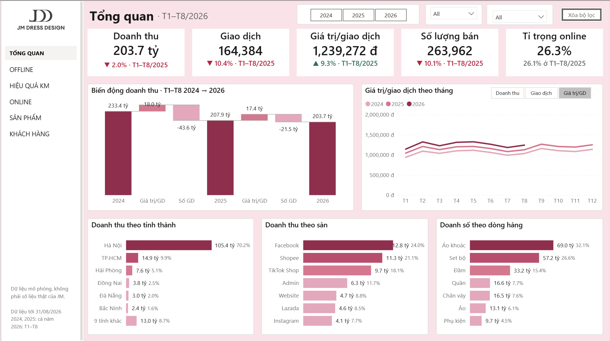
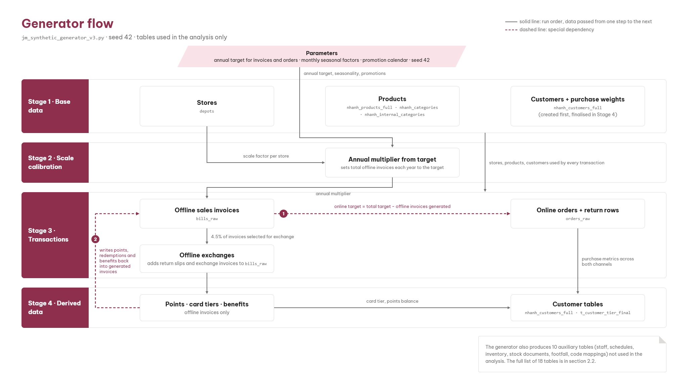

# JM Retail Analytics — Omnichannel retail analysis on synthetic data


> **Synthetic data.** All data in this repository was generated by the author in Python, based on JM's public scale, policies, prices and promotions. These are not JM's real figures and do not reflect JM's actual business performance.

*[Tiếng Việt](README.md) · English*

An end-to-end analytics project for JM, a Vietnamese fashion chain selling through 29 stores and 7 online channels: generating data that follows the structure of the Nhanh.vn sales system, modelling it in BigQuery, analysing it with SQL and Python, building a Power BI dashboard, and writing an insight report with recommendations. Scale: 18 tables, about 960,000 rows in the two transaction tables (store invoices and online orders), Jan 2024–Aug 2026.

**Key skills:** SQL (BigQuery) · Python (pandas, statistical modeling) · Power BI & DAX · Data Modeling & Data Quality · Customer Analytics · Statistical Inference

**Contents:** [Results](#results-and-business-implications) · [Documentation](#documentation) · [Dashboard](#dashboard) · [Approach](#approach) · [Repository structure](#repository-structure) · [Reproducing](#reproducing-the-project) · [Limitations](#limitations)



---

## Results and business implications

Jan–Aug 2026 compared with the same period of 2025. An *observation* is measured in the data; a *method test* checks an analytical approach. The → line gives the implication for the business; detailed figures, denominators and assumptions are in the [insight report](docs/en/insight-report.pdf).

1. *Observation.* **Revenue reached VND 203.7bn, down 2.0%.** Transactions fell 10.4%; revenue per transaction rose 9.3% because the average price per item rose 9.0%, while items per transaction stayed at about 1.6.
   → Transaction count is the main lever, not price increases: if prices stop rising, revenue for Jan–Aug 2027 would be about 10% lower (scenario, report section 8.1).
2. *Observation.* **Promotion days have 15.6–44.2% more invoices than baseline days in the same month, but average invoice value is 5.1–19.4% lower.** Black Friday, the one programme with a quantity condition, preserved invoice value best.
   → Test a "buy more, save more" mechanic for End of Season: an estimated additional VND 0.6–1.2bn in offline revenue per year (scenario, section 8.3, recommendation 6).
3. *Observation.* **TikTok Shop keeps revenue on 48.2% of placed orders, the lowest of the 7 online channels (69–77% on the other six).** The three ways an order is lost are measured separately, each with its own denominator; the largest is returns to sender (failed delivery, parcel sent back to the seller): 25.1% of placed orders, about twice the rate on the other channels.
   → Compare channels on revenue remaining after returns and marketplace fees, not on order volume (section 8.3, recommendation 9).
4. *Method test.* **A recency-based churn label (as commonly used in RFM segmentation) does not tell who will come back.** Following 35,638 identified customers from 31 August 2025 for 12 months, those labelled "lapsed" came back more often than those buying regularly (98% versus 85%), and within the same number of past purchase days the labels were almost identical. The commonly used purchase-interval formula also means a new customer who has come back once or twice can never be labelled "lapsed".
   → Test a churn label on a fixed customer cohort before using it to allocate retention budgets.

### What can synthetic data prove?

The data is generated from rules, so the test is whether a method recovers what was built in and does not find what is not there. The promotion model recovered all 7 built-in coefficients, each within its own 95% confidence interval, on a single generated dataset (seed 42, not yet tested across seeds); two signals that were not built in directly, the churn label and the 49% decline in new customers, are both explained by other mechanisms ([comparison table](docs/en/synthetic-data-design.md#4-checking-findings-against-the-generation-rules)). On real data, uplift is still only a comparison with baseline days, not a causal effect; and because the data has no churn mechanism, the return rates above say nothing about real-world retention.

---

## Documentation

| Document | Contents | Read it if |
|---|---|---|
| [Insight report](docs/en/insight-report.pdf) ([Markdown](docs/en/insight-report.md)) | Findings by dashboard page, prediction, 16 recommendations ranked by priority | You want the results and recommendations |
| [Methodology appendix](docs/en/methodology.md) | How each finding was tested, CLV model validation | You want to check the methods |
| [Synthetic data design](docs/en/synthetic-data-design.md) | Generation rules, 18 tables, findings checked against the rules | You want to know where the data comes from |
| [Technical documentation](docs/en/technical-notes.md) | BigQuery architecture, metric definitions, Power BI model, reconciliation | You want the architecture and how figures were checked |
| [Setup guide](docs/en/setup.md) ([Reference dataset](docs/en/reference-dataset.md)) | Configuration, data loading, run order; check figures to reconcile against | You want to rerun the project |

---

## Dashboard

Power BI, 6 main pages and 2 detail pages, in Vietnamese. Browse it as a [PDF](dashboard/jm-dashboard.pdf) or page by page below; open the [`.pbix`](dashboard/jm-dashboard.pbix) in Power BI Desktop to use the filters (data is embedded and cannot be refreshed).

| Page | Question |
|---|---|
| [Overview (Tổng quan)](dashboard/screenshots/01-overview.png) | What drove the change in revenue? |
| [Offline](dashboard/screenshots/02-offline.png) | Where does revenue sit within the store chain? |
| [Promotion effectiveness (Hiệu quả khuyến mãi)](dashboard/screenshots/03-promotions.png) | What do promotions deliver? |
| [Online](dashboard/screenshots/04-online.png) | Where is online revenue lost? |
| [Products (Sản phẩm)](dashboard/screenshots/05-products.png) | Where do sales come from within the range? |
| [Customers (Khách hàng)](dashboard/screenshots/06-customers.png) | Which customers generate revenue, and how many come back? |
| [Order losses by channel (Trả hàng theo sàn)](dashboard/screenshots/07-marketplace-detail.png) | Cancellations, returns to sender and customer returns for one channel (screenshot: TikTok Shop) |
| [Collection detail (Chi tiết BST)](dashboard/screenshots/08-collection-detail.png) | Sales, timing and mix of one collection (screenshot: the 8/3 collection, for Women's Day on 8 March) |

*Screenshots use dot decimals, as in this README. Tables with a scroll bar show only part of their rows; full figures are in the insight report.*

---

## Approach



**Data.** The generator writes 18 tables following the Nhanh.vn structure. The analysis uses 8 of them (invoices, online orders, products, categories, stores, customers); the other 10 (staff, inventory, footfall…) keep the system structure complete but carry no information of their own ([synthetic data design](docs/en/synthetic-data-design.md), section 2).

**Business questions and how they were answered**

| Question | Method |
|---|---|
| Did revenue fall because of fewer transactions or lower value per transaction? | Chain substitution: split the change into a part from transaction count and a part from value per transaction |
| How many extra invoices does a promotion bring compared with baseline days? | Daily quasi-Poisson regression, separating seasonality, weekends and overlapping programmes, with 95% confidence intervals. It cannot separate customers who only shifted their purchase date; that needs a control group |
| Are differences between stores, collections and product lines real or noise? | Compare each group's deviation with its standard error, measured at the level at which the data was generated |
| Which customers are most worth keeping? | CLV (BG/NBD and Gamma-Gamma), tested on Jan–Aug 2026: it ranked customers no better than past purchase count and overpredicted purchases by 34%, so its absolute values are not used |

**Reconciliation.** Each metric is defined once in BigQuery, and every dashboard page was reconciled with BigQuery before sign-off. Reconciliation caught a join error that inflated online sales by 11.1% without the query raising any error.

---

## Repository structure

```
├── README.md · README.en.md · LICENSE
├── requirements.txt            library versions verified for reproduction
├── docs/
│   ├── vi/ · en/               insight report, methodology, technical notes,
│   │                           synthetic data design, setup guide, reference dataset
│   ├── dax-time-patterns.md    DAX time-intelligence patterns
│   └── images/                 flow diagram, ERD
├── dashboard/                  .pbix, PDF, theme, screenshots of 8 pages
├── data-generator/             generates 18 tables · 57 data quality checks
├── data/reference/             CLV table of the reference dataset (Parquet)
├── sql/
│   ├── 01_staging_views.sql    standardises each channel
│   ├── 02_core_views.sql       shared definitions of revenue and sales
│   ├── 03_derived_tables.sql   analytical customer table, marketplace fee table
│   ├── 04_analysis_views.sql   views used during the analysis
│   └── 05_powerbi_views.sql    7 views for the dashboard, with check figures
├── models/                     CLV model, upload of CLV to BigQuery, promotion model
└── erd/                        ERD of the 10 tables used in the analysis, full 18-table ERD
```

---

## Reproducing the project

1. Generate the data with `data-generator/` and run the QA suite: no check may fail. The seed and reference date (7 September 2026) are fixed, so with the library versions in `requirements.txt` the data matches the dataset used in the report exactly (checked row by row; see the [reference dataset](docs/en/reference-dataset.md)).
2. Create a BigQuery dataset and load the 8 tables: tables with nested columns as NDJSON, flat tables as CSV.
3. Run the files in `sql/` and `models/` in order.
4. Point the `.pbix` data source at your BigQuery, refresh, and reconcile the figures with section 4 of the technical documentation.

Exact commands, the places where the project name must be changed, authentication and expected row counts are in the [Setup guide](docs/en/setup.md).

---

## Limitations

- **Synthetic data, not representative of JM's actual business:** findings reflect the data-generation rules ([see above](#what-can-synthetic-data-prove)). Some mechanisms are simplified: cost per item barely changes over three years, online revenue is before actual marketplace fees, and each customer's purchase rate does not change over time.
- **Not enough data to answer "why":** there is no usable store footfall, no marketplace traffic and no marketing or operating costs, so we know transactions fell but not why, and net profit cannot be computed.
- **Customer history starts in January 2024,** so early "new customers" include existing ones. Cross-channel customers are not analysed, because in a real business marketplaces do not share customer identities with stores.

---

## Author

**Rachel** · Data Analyst
[LinkedIn](https://www.linkedin.com/in/quynh-chau-nguyen-052b8619a/) · [GitHub](https://github.com/xbumbleboo) · [Email](mailto:chauaz221@gmail.com)
