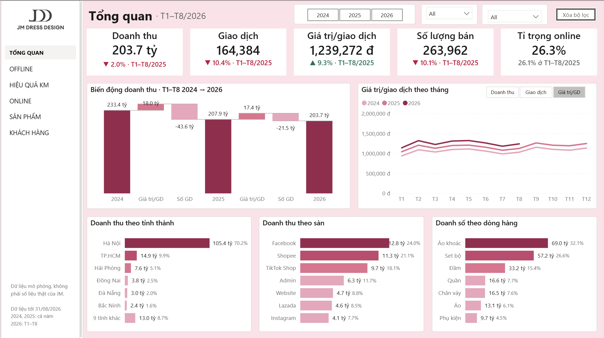
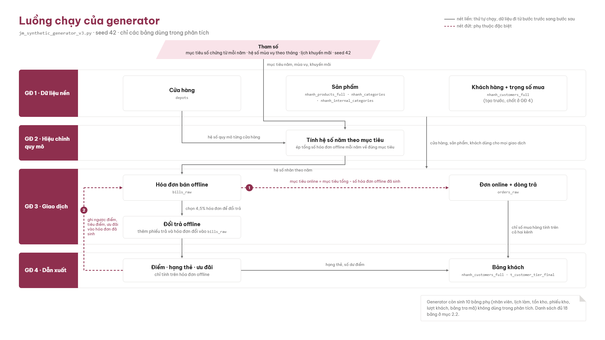

# JM Retail Analytics — Phân tích bán lẻ đa kênh trên dữ liệu mô phỏng


> **Dữ liệu mô phỏng.** Toàn bộ dữ liệu trong repo này do tác giả tự sinh bằng Python, dựa trên quy mô, chính sách, giá và chương trình khuyến mãi công khai của JM. Đây không phải số liệu thật của JM và không phản ánh tình hình kinh doanh của JM.

*Tiếng Việt · [English](README.en.md)*

Dự án phân tích trọn vòng cho JM, chuỗi thời trang Việt Nam bán qua 29 cửa hàng và 7 sàn online: sinh dữ liệu theo cấu trúc hệ thống bán hàng Nhanh.vn, mô hình hóa trên BigQuery, phân tích bằng SQL và Python, dựng dashboard Power BI và viết báo cáo insight kèm đề xuất. Quy mô: 18 bảng, khoảng 960.000 dòng ở hai bảng giao dịch (hóa đơn cửa hàng và đơn online), kỳ 01/2024–08/2026.

**Kỹ năng chính:** SQL (BigQuery) · Python (pandas, statistical modeling) · Power BI & DAX · Data Modeling & Data Quality · Customer Analytics · Statistical Inference

**Mục lục:** [Kết quả](#kết-quả-phân-tích-và-hàm-ý-kinh-doanh) · [Tài liệu](#tài-liệu) · [Dashboard](#dashboard) · [Cách làm](#cách-làm) · [Cấu trúc thư mục](#cấu-trúc-thư-mục) · [Tái dựng](#tái-dựng) · [Giới hạn](#giới-hạn)



---

## Kết quả phân tích và hàm ý kinh doanh

So sánh T1–T8/2026 với cùng kỳ 2025. *Quan sát* là số đo được trong dữ liệu; *kiểm định phương pháp* là phép thử một cách làm. Dòng → là hàm ý cho doanh nghiệp; số chi tiết, mẫu số và giả định ở [báo cáo insight](docs/vi/insight-report.pdf).

1. *Quan sát.* **Doanh thu đạt 203,7 tỷ đồng, giảm 2,0%.** Số giao dịch giảm 10,4%; giá trị mỗi giao dịch tăng 9,3% vì giá mỗi món tăng 9,0%, còn số món mỗi giao dịch giữ quanh 1,6.
   → Số giao dịch là đòn bẩy chính, không phải tăng giá: nếu giá ngừng tăng, doanh thu T1–T8/2027 thấp hơn khoảng 10% (kịch bản, báo cáo mục 8.1).
2. *Quan sát.* **Ngày khuyến mãi có số hóa đơn cao hơn 15,6–44,2% so với ngày nền cùng tháng, nhưng giá trị mỗi hóa đơn thấp hơn 5,1–19,4%.** Black Friday, chương trình duy nhất có điều kiện số lượng, giữ giá trị hóa đơn tốt nhất.
   → Thử cơ chế "mua nhiều giảm thêm" cho End of Season: ước tính thêm 0,6–1,2 tỷ doanh thu offline mỗi năm (kịch bản, mục 8.3, đề xuất 6).
3. *Quan sát.* **TikTok Shop giữ được doanh thu ở 48,2% số đơn đặt, thấp nhất trong 7 sàn (sáu sàn còn lại 69–77%).** Ba cách mất đơn được tính riêng, mỗi cách một mẫu số; lớn nhất là chuyển hoàn (giao không thành, hàng quay về shop): 25,1% đơn đặt, gấp khoảng 2 lần các sàn khác.
   → Đánh giá sàn trên doanh thu còn lại sau trả hàng và phí sàn, không trên số đơn đặt (mục 8.3, đề xuất 9).
4. *Kiểm định phương pháp.* **Nhãn rời bỏ theo độ gần lần mua (thường dùng trong phân khúc RFM) không cho biết ai sẽ quay lại.** Theo dõi 35.638 khách định danh từ 31/08/2025 trong 12 tháng: nhóm bị gắn nhãn "đã rời" quay lại nhiều hơn nhóm đang mua đều (98% so với 85%), và so trong cùng số ngày đã mua thì các nhãn gần như bằng nhau. Công thức nhịp mua thường dùng còn khiến khách mới quay lại 1–2 lần không bao giờ bị xếp vào nhóm "đã rời".
   → Kiểm nhãn rời bỏ bằng phép thử trên nhóm khách cố định trước khi dùng nó để phân bổ ngân sách giữ chân.

### Dữ liệu mô phỏng thì chứng minh được gì?

Dữ liệu sinh từ quy tắc, nên phép thử là phương pháp có tìm lại đúng những gì đã cài và không tìm ra thứ không có. Mô hình khuyến mãi tìm lại cả 7 hệ số đã cài trong khoảng tin cậy 95% của từng hệ số, trên một lần sinh dữ liệu (seed 42, chưa thử nhiều seed); hai tín hiệu không được cài trực tiếp, nhãn rời bỏ và mức giảm 49% khách mới, đều được giải thích bằng cơ chế khác ([bảng đối chiếu](docs/vi/synthetic-data-design.md#4-đối-chiếu-phát-hiện-với-quy-tắc-sinh-dữ-liệu)). Trên dữ liệu thật, uplift vẫn chỉ là so sánh với ngày nền, không phải tác động nhân quả; và vì dữ liệu không có cơ chế rời bỏ, các tỉ lệ quay lại ở trên không nói về khả năng giữ chân thực tế.

---

## Tài liệu

| Tài liệu | Nội dung | Đọc khi |
|---|---|---|
| [Báo cáo insight](docs/vi/insight-report.pdf) ([Markdown](docs/vi/insight-report.md)) | Phát hiện theo từng trang dashboard, dự đoán, 16 đề xuất xếp theo ưu tiên | Muốn biết kết quả và đề xuất |
| [Phụ lục phương pháp](docs/vi/methodology.md) | Cách kiểm từng phát hiện, kiểm định mô hình CLV | Muốn kiểm cách làm |
| [Thiết kế dữ liệu mô phỏng](docs/vi/synthetic-data-design.md) | Quy tắc sinh dữ liệu, 18 bảng, đối chiếu phát hiện với quy tắc | Muốn biết dữ liệu đến từ đâu |
| [Tài liệu kỹ thuật](docs/vi/technical-notes.md) | Kiến trúc BigQuery, định nghĩa chỉ số, mô hình Power BI, kiểm số | Muốn xem kiến trúc và cách kiểm số |
| [Hướng dẫn tái dựng](docs/vi/setup.md) ([Bộ dữ liệu tham chiếu](docs/vi/reference-dataset.md)) | Cấu hình, nạp dữ liệu, thứ tự chạy; số kiểm để đối chiếu | Muốn chạy lại dự án |

---

## Dashboard

Power BI, 6 trang chính và 2 trang chi tiết. Xem nhanh bằng [PDF](dashboard/jm-dashboard.pdf) hoặc ảnh từng trang; mở [`.pbix`](dashboard/jm-dashboard.pbix) bằng Power BI Desktop để lọc (dữ liệu nhúng sẵn, không refresh được).

| Trang | Câu hỏi |
|---|---|
| [Tổng quan](dashboard/screenshots/01-overview.png) | Doanh thu thay đổi vì đâu? |
| [Offline](dashboard/screenshots/02-offline.png) | Doanh thu nằm ở đâu trong chuỗi cửa hàng? |
| [Hiệu quả khuyến mãi](dashboard/screenshots/03-promotions.png) | Khuyến mãi mang lại gì? |
| [Online](dashboard/screenshots/04-online.png) | Doanh thu online mất đi ở đâu? |
| [Sản phẩm](dashboard/screenshots/05-products.png) | Doanh số đến từ đâu trong danh mục? |
| [Khách hàng](dashboard/screenshots/06-customers.png) | Doanh thu đến từ những khách nào, bao nhiêu khách quay lại? |
| [Trả hàng theo sàn](dashboard/screenshots/07-marketplace-detail.png) | Hủy, chuyển hoàn, trả hàng của một sàn (ảnh: TikTok Shop) |
| [Chi tiết BST](dashboard/screenshots/08-collection-detail.png) | Doanh số, thời điểm bán, cơ cấu của một BST (ảnh: BST 8/3) |

*Ảnh chụp dùng dấu chấm thập phân theo định dạng vùng của máy dựng dashboard. Bảng có thanh cuộn chỉ hiện một phần; số đầy đủ ở báo cáo insight.*

---

## Cách làm



**Dữ liệu.** Generator sinh 18 bảng theo cấu trúc Nhanh.vn. Phân tích dùng 8 bảng (hóa đơn, đơn online, sản phẩm, danh mục, cửa hàng, khách); 10 bảng còn lại (nhân sự, tồn kho, lượt khách…) giữ đủ cấu trúc hệ thống nhưng không mang thông tin riêng ([thiết kế dữ liệu mô phỏng](docs/vi/synthetic-data-design.md), mục 2).

**Câu hỏi kinh doanh và cách trả lời**

| Câu hỏi | Cách làm |
|---|---|
| Doanh thu giảm vì ít giao dịch hay vì giá trị mỗi giao dịch? | Thay thế liên hoàn: tách phần do số giao dịch và phần do giá trị mỗi giao dịch |
| Khuyến mãi kéo thêm bao nhiêu hóa đơn so với ngày nền? | Hồi quy quasi-Poisson theo ngày, tách mùa vụ, cuối tuần và chương trình trùng ngày, kèm khoảng tin cậy 95%. Không tách được phần khách chỉ dời ngày mua; việc đó cần nhóm đối chứng |
| Chênh lệch giữa cửa hàng, BST, dòng hàng là thật hay nhiễu? | So độ lệch của từng nhóm với sai số chuẩn, đo ở đúng đơn vị dữ liệu được sinh |
| Khách nào đáng giữ nhất? | CLV (BG/NBD và Gamma-Gamma), kiểm trên T1–T8/2026: xếp hạng không tốt hơn cách xếp theo số lần đã mua, và dự báo số lần mua cao hơn thực tế 34%, nên không dùng giá trị tuyệt đối |

**Kiểm số.** Mỗi chỉ số được định nghĩa một lần trên BigQuery, và mỗi trang dashboard được đối chiếu với BigQuery trước khi chốt. Phép đối chiếu từng bắt được một lỗi join làm doanh số online dư 11,1% mà truy vấn không báo lỗi gì.

---

## Cấu trúc thư mục

```
├── README.md · README.en.md · LICENSE
├── requirements.txt            phiên bản thư viện đã kiểm tái lập
├── docs/
│   ├── vi/ · en/               báo cáo insight, phương pháp, tài liệu kỹ thuật,
│   │                           thiết kế dữ liệu, hướng dẫn tái dựng, bộ dữ liệu tham chiếu
│   ├── dax-time-patterns.md    khuôn DAX thời gian
│   └── images/                 sơ đồ luồng, ERD
├── dashboard/                  .pbix, PDF, theme, ảnh 8 trang
├── data-generator/             sinh 18 bảng · 57 phép kiểm chất lượng
├── data/reference/             bảng CLV của bộ dữ liệu tham chiếu (Parquet)
├── sql/
│   ├── 01_staging_views.sql    chuẩn hóa từng kênh
│   ├── 02_core_views.sql       định nghĩa doanh thu, doanh số dùng chung
│   ├── 03_derived_tables.sql   bảng khách phân tích, bảng phí sàn
│   ├── 04_analysis_views.sql   view dùng trong giai đoạn phân tích
│   └── 05_powerbi_views.sql    7 view cho dashboard, kèm số kiểm
├── models/                     mô hình CLV, nạp CLV lên BigQuery, mô hình khuyến mãi
└── erd/                        ERD 10 bảng dùng trong phân tích, ERD đủ 18 bảng
```

---

## Tái dựng

1. Sinh dữ liệu bằng `data-generator/` và chạy bộ kiểm chất lượng: phải không có phép kiểm nào sai. Seed và ngày gốc (07/09/2026) cố định, nên với các phiên bản thư viện trong `requirements.txt`, dữ liệu khớp chính xác bộ dùng trong báo cáo (đã kiểm từng dòng, xem [bộ dữ liệu tham chiếu](docs/vi/reference-dataset.md)).
2. Tạo dataset BigQuery, nạp 8 bảng: bảng có cột lồng ở dạng NDJSON, bảng phẳng ở dạng CSV.
3. Chạy các file trong `sql/` và `models/` theo thứ tự.
4. Đổi nguồn của `.pbix` sang BigQuery của bạn, refresh, đối chiếu số theo tài liệu kỹ thuật mục 4.

Lệnh cụ thể, các chỗ cần đổi tên project, cách xác thực và số dòng kỳ vọng ở [Hướng dẫn tái dựng](docs/vi/setup.md).

---

## Giới hạn

- **Dữ liệu mô phỏng, không đại diện cho hoạt động kinh doanh thật của JM:** phát hiện phản ánh quy tắc sinh dữ liệu ([xem trên](#dữ-liệu-mô-phỏng-thì-chứng-minh-được-gì)). Một số cơ chế được giản lược: giá vốn gần như không đổi qua ba năm, doanh thu online chưa trừ phí sàn thực tế, tần suất mua của mỗi khách không đổi theo thời gian.
- **Thiếu dữ liệu để trả lời "vì sao":** không có lượt khách vào cửa hàng dùng được, lượt truy cập trên sàn, chi phí marketing và vận hành, nên chưa biết vì sao số giao dịch giảm và không tính được lợi nhuận ròng.
- **Lịch sử khách bắt đầu từ 01/2024,** nên "khách mới" giai đoạn đầu gồm cả khách cũ. Không phân tích khách mua đa kênh, vì ở doanh nghiệp thật các sàn không chia sẻ định danh khách với cửa hàng.

---

## Tác giả

**Rachel** · Data Analyst
[LinkedIn](https://www.linkedin.com/in/quynh-chau-nguyen-052b8619a/) · [GitHub](https://github.com/xbumbleboo) · [Email](mailto:chauaz221@gmail.com)
