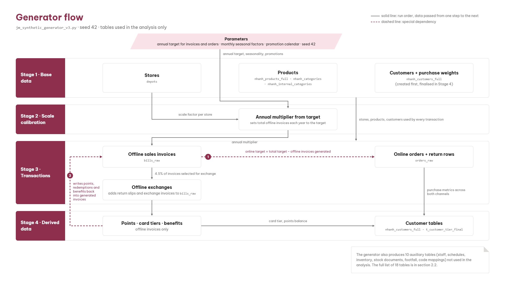
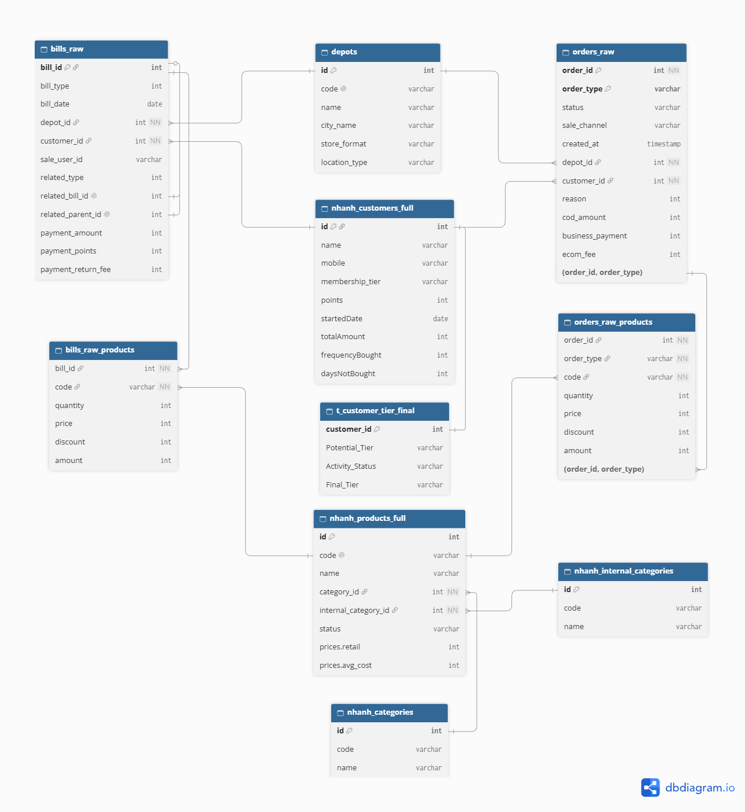

# Synthetic Data Design — JM Synthetic Data

> **Synthetic data.** All data in this project was generated by the author in Python, based on JM's public scale, policies, prices and promotions. These are not JM's real figures and do not reflect JM's actual business performance.

*Version 14/11/2026 · Generator v3.1 ([`data-generator/generate_data.py`](../../data-generator/generate_data.py), seed 42) · Companion to [#3 Insight Report](insight-report.md)*

**Relation to [#3](insight-report.md).** The insight report ([#3](insight-report.md)) is written from the point of view of someone who sees only the data. This document covers the rest: how the data was generated, what each parameter is based on, which rule produced each finding in [#3](insight-report.md), and where the data differs from reality.

**Summary**
- The dataset has 18 tables following the Nhanh.vn structure, with about 960 thousand transaction rows (01/2024–08/2026), built from research into JM's public business information. Every parameter states its basis: confirmed from a source, or set by the author.
- The 16 groups of findings in [#3](insight-report.md) were checked against the rules that generated the data: none contradicts the rules. The promotion model recovered all 7 built-in coefficients within the 95% confidence interval.
- Two signals that look real but are not in the rules (the "churn risk" label and the fall in new customers) were fully explained by other mechanisms in [#3](insight-report.md).
- The document states where the data differs from reality and which questions it cannot answer.

---

## 1. Why build this dataset

While working at JM, I came to understand quite well how a multichannel fashion chain operates: stores and marketplaces, the loyalty programme, the promotion calendar, how orders move through the system. I had not had the chance to work with the data from those processes systematically, from end to end. This project is how I created that chance for myself: build a synthetic dataset from what JM makes public, then analyse it as if it were real data.

**Process**
1. **Research the business** from public sources: jm.com.vn, the seller centres of Shopee, TikTok Shop and Lazada, the Nhanh.vn API documentation.
2. **Write the generation rules** as parameters, constraints and formulas.
3. **Generate the data** with a fixed seed so that reruns give identical results, then run a QA suite of 57 checks.
4. **Fix at the source:** business errors are corrected in the rules document first, then in the code; the generator went through three versions.
5. **Analyse it as real data,** and only then check the results against the rules (section 4).

**Basis labels** used in section 3: **Confirmed** (public sources from JM, the marketplaces, Nhanh.vn) · **Decision** (based on the author's knowledge of how JM operates) · **Inferred** (general industry figures) · **Assumption** (set by the author). Most quantitative coefficients are assumptions, and this is deliberate: when the true value is known in advance, it is possible to check whether an analysis method recovers it. Real data does not allow this.

---

## 2. Data architecture

### 2.1 Generation flow



The generator runs in four stages:
1. **Base data:** stores, products, customers; each customer is given a fixed purchase weight.
2. **Scale calibration:** one multiplier per year so that the total number of offline invoices matches the annual target.
3. **Transactions:** offline sales invoices, online orders, offline exchanges.
4. **Derived data:** points, card tiers, benefits; the customer table computes purchase metrics across both channels.

Two dependencies leave traces in the data:
- **Online is generated after offline:** the online order target = annual total target − offline invoices already generated.
- **Points and benefits are written back** into the offline invoices. The stock-document table `nhanh_bills_full` is built before this step, so its amounts differ from `bills_raw` on invoices that used points or benefits.

### 2.2 Tables



The generator writes 18 tables. **The analysis uses 8:** `depots`, `nhanh_products_full`, `nhanh_categories`, `nhanh_internal_categories`, `nhanh_customers_full`, `t_customer_tier_final`, `bills_raw`, `orders_raw`. The ERD also shows `bills_raw_products` and `orders_raw_products`, which are the nested `products` column split out into tables to show the relationship between invoices and products. **10 tables are not used:** staff, work schedule, stock documents, 3 inventory tables, 2 Palexy footfall tables (no signal of their own, section 6) and 2 code-mapping tables. Full ERD of all 18 tables: [`erd/erd_day_du_18_bang.dbml`](../../erd/erd_day_du_18_bang.dbml).

**Scale (seed 42):** 32 stores and warehouses · 7,213 SKUs · 39,534 customers · 542,301 offline documents · 417,981 online order rows.

**Before writing queries:**
- The key of `orders_raw` is `(order_id, order_type)`, because return rows reuse the `order_id` of the original order.
- `bills_raw` has two self-references: return slip → original invoice, exchange invoice → return slip.
- There is no parent-product row. The parent code is the part of the SKU code before the first `-`.

From these tables to BigQuery and the dashboard: **[#6 Technical Documentation](technical-notes.md)**.

---

## 3. Generation rules

### 3.1 Time and scale

| Parameter | Value | Meaning and purpose | Basis |
|---|---|---|---|
| Invoices and orders per year | 400,000 · 325,000 · 180,000 (Jan–Aug 2026); online about 45% | Creates a declining trend in transactions over the years | Assumption: estimated from the chain's scale |
| Monthly factor | Jan 1.35 · Feb 0.70 · Mar 0.85 · Apr 1.00 · May 1.05 · Jun 0.95 · Jul 0.80 · Aug 0.85 · Sep 1.00 · Oct 1.05 · Nov 1.20 · Dec 1.40 | Purchases in the month relative to an ordinary month (1.00): 1.35 means 35% more. Creates a known seasonal pattern | The business documents only state the pattern qualitatively (peaks in Dec and Jan; troughs in Feb, Mar, Jul, Aug); the figures are assumptions |
| Weekend | ×1.35 | Tests whether a model can separate the day-of-week effect | Assumption |
| Price increase | 9% per year | Makes revenue and transactions move in opposite directions | Assumption |

The three time factors are multiplied together and shared by every store and every channel:

```python
def seasonality_factor(d):
    base = {1: 1.35, 2: 0.70, ...}[d.month]   # monthly factor
    base *= event_effect(d)[0]                # promotion factor for that day (section 3.2)
    if d.weekday() >= 5:                      # Saturday, Sunday
        base *= 1.35
    return base
```

**Calibration to the annual target.** The generator adds up the expected number of invoices for every store over every day of the year, then divides the annual target by that total to get one common multiplier. Every store is multiplied by the same factor, so the ratios between stores, between months and between promotion days and ordinary days are preserved. The multiplier is computed after promotion effects are included, so promotions only shift purchases within the year and do not make the annual total larger.

### 3.2 Promotions

| Programme | Window | Traffic factor | Extra discount |
|---|---|---:|---:|
| Year-end Clearance & Spring | 01/01–25/01 | ×1.30 | 15% |
| Hot Sale 8/3 (Women's Day) | 01/03–08/03 | ×1.45 | 20% |
| 30/4 – 1/5 holiday | 27/04–03/05 | ×1.25 | 10% |
| JM Anniversary Sale | 20/06–15/07 | ×1.25 | 15% |
| Mid-month Sale 15/7 | 13/07–17/07 | ×1.20 | 10% |
| End of Season Sale | 20/07–20/08 | ×1.15 | 15% |
| Black Friday | 30/10–13/11 | ×1.45 | 30% + 4-item rule |
| New collection launch | 01/10–31/12 | ×1.10 | 5% |

- **Programme names:** Confirmed, from JM's public promotion calendar. Date windows are fixed every year; Black Friday differs from reality (section 5).
- **Traffic factor:** invoices on a promotion day relative to an ordinary day (×1.45 means 45% more). Assumption: programmes with deeper discounts get higher factors. Used to create different uplifts between programmes. When two programmes overlap, the higher factor applies.
- **Extra discount:** each line item already has its own discount (section 3.4). On a promotion day, the extra discount is **added** to every line, capped at 70%. Example in Hot Sale 8/3: a full-price top gets 20% off, a top already 10% off goes to 30% off. Each programme's level is an assumption; the 70% cap is Confirmed. Used to create the relationship "the deeper the discount, the lower the order value".
- **Black Friday:** invoices of 4 or more items have every line raised to at least 15% off; each line has a 35% chance of being raised to 2 units. The "buy 4, get 15% off" tier is Confirmed (Black Friday 2025); the buy-2 and buy-3 tiers are not simulated; the 35% rate is an assumption.

### 3.3 Stores and customers

| Parameter | Value | Meaning and purpose | Basis |
|---|---|---|---|
| Daily invoice range | Tier 1 (Hanoi) 70–110 · tier 2 (Ho Chi Minh City, Hai Phong, Da Nang) 35–75 · tier 3 12–30 | Relative scale between market tiers | Assumption |
| Scale factor | 0.62–1.45; shopping mall ×1.28; city centre ×1.18 | Fixed scale differences between stores | Assumption |
| AOV factor | Tier 1/2/3 = 1.12/1.00/0.90; shopping mall ×1.06; city centre ×1.03 | Shifts product choice towards more expensive (> 1) or cheaper (< 1) items | Assumption |
| Hai Phong AOV factor | ×0.80 | Price level about 20% lower | Confirmed |
| Customer base | 75,000 customers created once at the start; 39,531 remain with transactions | No new customers arrive after the start, no customers leave | Assumption: keeps the interval between two offline purchases within 60–90 days |
| Purchase weight | Gamma, shape 0.18 | Most customers have small weights, a small group very large ones; each transaction draws one customer by weight. Creates revenue concentration | Assumption, calibrated so that card tiers decrease from Member to Diamond |
| Shared accounts | 3 accounts take 8% of offline invoices and no online orders | Customers who leave no phone number at the till; marketplaces always pass a buyer ID | Confirmed (rule) · Assumption (8%) |

The **store network** of 29 stores in 15 provinces (11 in Hanoi, 5 in shopping malls) and the **loyalty programme** are Confirmed: card tiers based on offline spending over 365 days (VND 0/5/15/25/40m), points of 1–8% by tier, birthday discounts of 15–30%, exchange windows of 7 or 30 days by tier, and a tier reset on 01/01/2026. The remaining rates are assumptions: 20% of invoices redeem points, tier-upgrade discounts of 5–12%, 4.5% of invoices exchanged (offline returns are always exchanges, a Decision).

### 3.4 Online and products

| Parameter | Value | Basis |
|---|---|---|
| Online channel mix | TikTok Shop 25% · Facebook 22% · Shopee 20% · Admin 10% · Website 8% · Lazada 8% · Instagram 7% | Assumption |
| Order status | Other channels: delivered 78%, returned to sender 12%, cancelled 10%. TikTok Shop: 62% / 25% / 13% | Inferred: 20–30% return rates for fashion sold via livestream |
| Returns after delivery | TikTok Shop 24.3% · Shopee 11.6% · Lazada 10% · Facebook, Instagram, Website 8% · Admin 1% | Inferred |
| Return and cancellation reasons | Wrong size 65%, not as described 15%, defective 10%, wrong item 5%, lost 5%; cancellation reasons drawn evenly from 16 codes | Inferred · Assumption |
| Channel fees | By effective date range for each marketplace, separating fees refunded and not refunded on returns | Confirmed, except Shopee's 3% commission (Inferred) |
| List price ranges (2024) | Tops 250–650k · Dresses 450k–1.2m · Trousers 350–750k · Skirts 300–700k · Sets 600k–1.5m · Outerwear 700k–1.8m · Accessories 150–350k (VND) | Confirmed |
| Range | 600 styles × 4 sizes × 2–4 colours = 7,213 SKUs; 20 collections, each style assigned to one at random | Assumption (collection names Confirmed) |
| Cost of goods | 35–45% of list price, drawn once per style, not rising over time | Assumption |
| Standing discount | 55% of lines at full price · 30% at 10–20% off · 15% at 30–50% off | Assumption: everyday sale items |
| Holiday collections | TẾT, 14/2, 8/3 weighted 3 times in product selection during their holiday window | Assumption |

---

## 4. Checking findings against the generation rules

The analysis ([#3](insight-report.md)) was done first, using the data alone; the check was done afterwards. A sound method must recover what was built in, and must not find what is not there. Because the author also wrote the generator, every conclusion in [#3](insight-report.md) has to stand on tests run on the data, not on knowledge of the rules.

| Finding in [#3](insight-report.md) | Rule that produced it | Result |
|---|---|---|
| Seasonal peak in January, trough in February, same shape in all three years; weekends 1.34–1.37 times weekdays | Monthly factor, weekend ×1.35 | Matches |
| [#3](insight-report.md) does not attribute the February trough to Tết | Factors follow calendar months; no Tết effect | Right not to conclude |
| Value per transaction rose because of price (+9.0% per item); every store, channel, product line and collection fell by about the same rate | Price ×1.09 per year; one common annual multiplier | Matches |
| Uplift by programme; the deeper the discount, the lower the AOV | Traffic factor; extra discount added to every line | Matches, see table below |
| Black Friday protects AOV (−5.1%), UPT 2.11 against 1.71 | 4-item rule | Matches |
| [#3](insight-report.md) warns that uplift does not prove extra full-year revenue | Annual multiplier computed after promotions | Matches |
| Hanoi 70.2% of offline revenue; stable rankings; store-level YoY is noise | Tier ranges, fixed scale factor, common annual multiplier | Matches |
| AOV by tier, mall, city centre; Hai Phong −28% | AOV factor | Matches in direction and order; measured gaps are larger because the factor also shifts product choice |
| Only 48.2% of TikTok Shop orders keep revenue; returned to sender 25.1%, cancelled 12.7% | Weights 62/25/13 | Matches to the percentage point |
| Return reasons do not differ by channel; cancellation reasons are even | Drawn independently; drawn evenly | Matches |
| Online sells fewer high-priced items; [#3](insight-report.md) does not assign a cause | Online orders choose products without the AOV factor | Right not to assign a cause |
| Product lines rank by price, collections by number of styles; TẾT 40.8% of January sales | Price range by line; random collection assignment; ×3 during holiday | Matches |
| Discounts of the three holiday collections rank TẾT > 8/3 > 14/2 | TẾT and 8/3 windows overlap promotions | Matches. The data cannot separate the collection effect from the promotion effect; in a real business, such overlap is usually planned |
| Top 10% of customers generate 40.9%; AOV of the 5 card tiers nearly equal | Gamma weights; product choice independent of customer | Matches |
| The "churn risk" label predicts nothing; new customers −48.9% says nothing about acquisition | No churn mechanism; fixed customer base | **Correctly not concluded** |
| CLV overpredicts by about 34%; used for ranking only | Purchase intensity falls with the annual target | Consistent with the limitation stated in [#3](insight-report.md) |

| Programme | Built-in factor | Measured invoice uplift |
|---|---:|---:|
| Hot Sale 8/3 | ×1.45 | +44.2% ±3.5 |
| Black Friday | ×1.45 / baseline ×1.10 = +31.8% | +32.2% ±2.7 |
| Year-end Clearance & Spring | ×1.30 | +30.2% ±3.2 |
| JM Anniversary | ×1.25 | +23.2% ±2.3 |
| 30/4 – 1/5 holiday | ×1.25 | +23.0% ±2.8 |
| Mid-month Sale 15/7 | ×1.20 | +18.0% ±6.1 |
| End of Season | ×1.15 | +15.6% ±2.3 |

All 7 factors fall within the 95% confidence interval (pooled 2024–2026). Split by year, 19 of 20 year × programme cells contain the built-in factor. The other is 30/4 – 1/5 in 2024 (+19.5% ±4.3); with 95% intervals, about 1 cell in 20 is expected to fall outside.

**Two lessons that apply to real data:**
- **"New customers" and churn labels need a cohort test.** Here, a fixed customer base alone is enough to produce a 49% fall in new customers and a useless churn label, although no customer arrives or leaves.
- **Uplift against ordinary days is not incremental revenue.** Measuring the true incremental effect needs a control group.

---

## 5. Fidelity to the business

| Item | In the data | In reality | Impact |
|---|---|---|---|
| Black Friday | 30/10–13/11; 30% extra; 4+ items at least 15% off | 2024: 12–21/11, buy 2 get 10% off, buy 3 get 15% off. 2025: buy 2/3/4 get 5/10/15% off. Up to 70% off and fixed prices from VND 111k | The conclusion still holds in direction; recommendation 6 in [#3](insight-report.md) follows the real tiered mechanism |
| Collections across years | Same list of styles every year | New styles and colours each year | Collection stability across years is not used to judge selling strength |
| Parent products | No separate row | Nhanh.vn stores them as separate rows | Parent code taken from the SKU code, matching 7,213/7,213 |
| Online revenue | 92% of order value on every channel | Each marketplace deducts different fees | Profit is not compared between channels |
| Other | Only 3 stock-document types (8 in reality); no lifestyle accessories at VND 250–500k; order statuses stored as text (codes in reality) | | No impact on conclusions |

**Deliberate simplifications:** no customer churn and no new customers arriving; cost of goods does not rise over time and list prices stay at 2024 levels, so neither is used as a denominator; invoices that redeem points record zero discount, so discount rates and margins are computed only on invoices without points; inventory has no real stock-outs and no end-of-season markdowns.

---

## 6. Data limitations

| Question | Why it cannot be answered yet | What is needed |
|---|---|---|
| Did transactions fall because fewer people came, or because conversion fell? | Footfall is derived backwards from invoice counts | Footfall independent of invoices |
| Do customers churn; is acquisition improving or weakening? | Fixed customer base | A churn mechanism; new customers arriving by channel and promotion |
| Net profit, marketing effectiveness? | No costs beyond cost of goods | Marketing costs by programme and channel |
| Which tier of "buy more, save more" works best? | Only the 4-item tier is simulated | Black Friday as a 2/3/4-item ladder |
| Margin by product line or collection? | Cost of goods is random by style | Cost by product line, rising over time |
| Do new collections sell well; do stock-outs lose revenue? | Collections keep the same styles; inventory derived from sales | A new collection each year; real stock-outs |
| Why do customers cancel; which hours sell best; which staff sell best? | Cancellation reasons, purchase times and staff are all random | Patterns in these fields |
| How do cross-channel customers behave? | Real businesses cannot link customers between marketplaces and stores, so this is not analysed even though the synthetic data links them | |

---

## Sources

- Business rules document (with a source label for every item) and data generation rules: working documents in Vietnamese, not included in the repo; the rules used in the analysis are summarised in [section 3](#3-generation-rules).
- [`data-generator/generate_data.py`](../../data-generator/generate_data.py), [`data-generator/qa_checks.py`](../../data-generator/qa_checks.py): generation and quality-check code.
- [`erd/erd_loi_10_bang.dbml`](../../erd/erd_loi_10_bang.dbml), [`erd/erd_day_du_18_bang.dbml`](../../erd/erd_day_du_18_bang.dbml): core ERD and full ERD.
- [#3 Insight Report](insight-report.md): the findings checked in section 4.
- [#5 Methodology Appendix](methodology.md): the main testing methods.
- [#6 Technical Documentation](technical-notes.md): from the generator to BigQuery and the dashboard.
