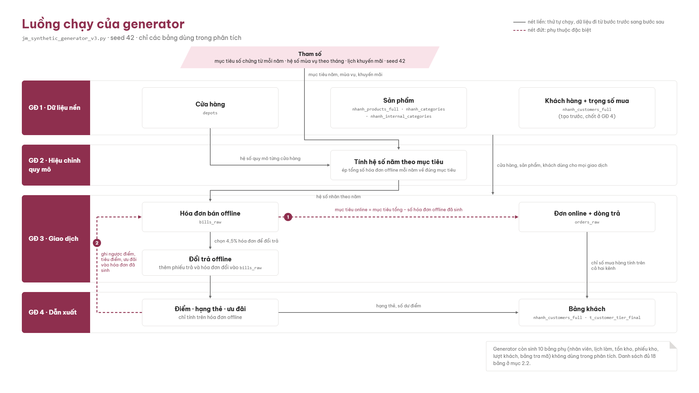
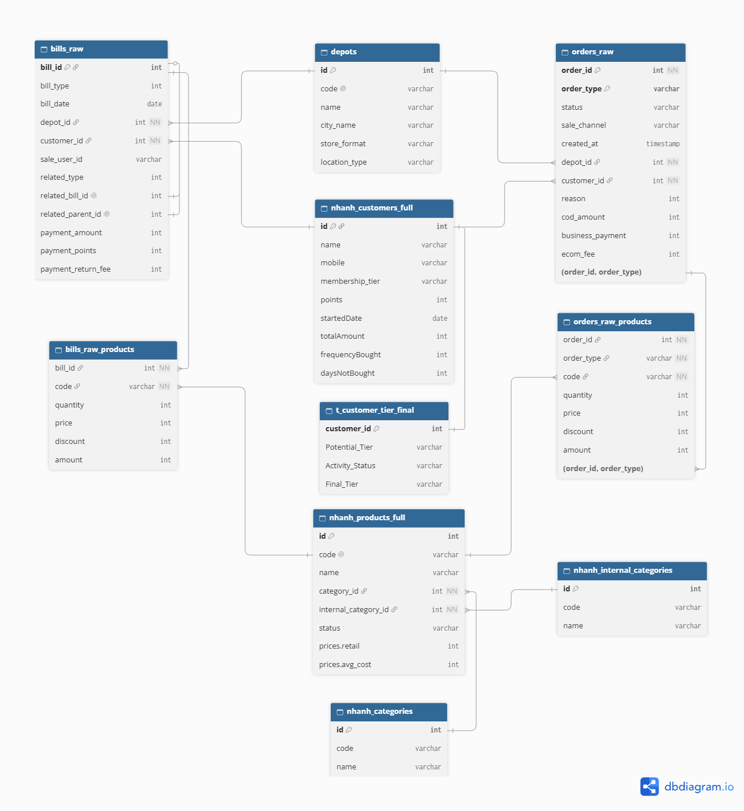

# Thiết kế dữ liệu mô phỏng — JM Synthetic Data

> **Dữ liệu mô phỏng.** Toàn bộ dữ liệu trong dự án do tác giả tự sinh bằng Python, dựa trên quy mô, chính sách, giá và chương trình khuyến mãi công khai của JM. Đây không phải số liệu thật của JM và không phản ánh tình hình kinh doanh của JM.

*Bản 14/11/2026 · Generator v3.1 ([`data-generator/generate_data.py`](../../data-generator/generate_data.py), seed 42) · Đi kèm [#3 Báo cáo insight](insight-report.md)*

**Quan hệ với [#3](insight-report.md).** Báo cáo insight ([#3](insight-report.md)) được viết từ góc nhìn của người chỉ thấy dữ liệu. Tài liệu này mở phần còn lại: dữ liệu được sinh ra thế nào, mỗi tham số dựa trên cơ sở nào, phát hiện nào trong [#3](insight-report.md) bắt nguồn từ quy tắc nào, và dữ liệu khác thực tế ở đâu.

**Tóm tắt**
- Bộ dữ liệu gồm 18 bảng theo cấu trúc Nhanh.vn, khoảng 960 nghìn dòng giao dịch (01/2024–08/2026), dựng từ nghiên cứu nghiệp vụ công khai của JM. Mỗi tham số ghi rõ cơ sở: xác nhận từ nguồn, hay tự đặt.
- Đối chiếu 16 nhóm phát hiện của [#3](insight-report.md) với quy tắc đã sinh ra dữ liệu: không phát hiện nào mâu thuẫn với quy tắc. Mô hình đo khuyến mãi tìm lại cả 7 hệ số đã cài, trong khoảng tin cậy 95%.
- Hai tín hiệu trông như thật nhưng không có trong quy tắc (nhãn "có nguy cơ rời bỏ" và mức giảm khách mới) đã được [#3](insight-report.md) giải thích đầy đủ bằng cơ chế khác.
- Tài liệu ghi rõ dữ liệu khác thực tế ở đâu và câu hỏi nào chưa trả lời được.

---

## 1. Vì sao dựng bộ dữ liệu này

Trong thời gian làm việc tại JM, tôi hiểu khá rõ cách một chuỗi thời trang đa kênh vận hành: cửa hàng và sàn TMĐT, chương trình thành viên, lịch khuyến mãi, cách đơn hàng đi qua hệ thống. Tôi chưa có dịp làm việc với dữ liệu của những quy trình đó một cách bài bản, từ đầu đến cuối. Project này là cách tôi tự tạo cơ hội đó: dựng một bộ dữ liệu mô phỏng dựa trên những gì JM công bố, rồi phân tích nó như phân tích dữ liệu thật.

**Quy trình**
1. **Nghiên cứu nghiệp vụ** từ nguồn công khai: jm.com.vn, trang người bán của Shopee, TikTok Shop, Lazada, tài liệu API Nhanh.vn.
2. **Viết quy tắc sinh dữ liệu** thành tham số, ràng buộc và công thức.
3. **Sinh dữ liệu** với seed cố định để chạy lại ra đúng kết quả, rồi chạy bộ QA 57 kiểm tra.
4. **Sửa tại nguồn:** lỗi nghiệp vụ được sửa trong tài liệu quy tắc trước, rồi mới sửa code; generator qua ba phiên bản.
5. **Phân tích như dữ liệu thật,** rồi mới đối chiếu kết quả với quy tắc (mục 4).

**Nhãn cơ sở** dùng ở mục 3: **Xác nhận** (nguồn công khai của JM, sàn, Nhanh.vn) · **Quyết định** (theo hiểu biết vận hành JM của tác giả) · **Suy luận** (số liệu chung của ngành) · **Giả định** (tự đặt). Phần lớn hệ số định lượng là giả định, và đây là chủ đích: biết trước giá trị đúng thì kiểm được phương pháp phân tích có tìm lại đúng giá trị đó không. Dữ liệu thật không cho phép làm điều này.

---

## 2. Kiến trúc dữ liệu

### 2.1 Luồng sinh dữ liệu



Generator chạy qua bốn giai đoạn:
1. **Dữ liệu nền:** cửa hàng, sản phẩm, khách hàng; mỗi khách được gắn một trọng số mua cố định.
2. **Hiệu chỉnh quy mô:** tính một hệ số nhân mỗi năm để tổng số hóa đơn offline khớp mục tiêu năm.
3. **Giao dịch:** hóa đơn bán offline, đơn online, đổi trả offline.
4. **Dẫn xuất:** điểm, hạng thẻ, ưu đãi; bảng khách tính chỉ số mua trên cả hai kênh.

Hai phụ thuộc để lại dấu vết trong dữ liệu:
- **Online sinh sau offline:** mục tiêu đơn online = mục tiêu tổng năm − số hóa đơn offline đã sinh.
- **Điểm và ưu đãi được ghi ngược** vào hóa đơn offline. Bảng phiếu kho `nhanh_bills_full` dựng trước bước này, nên lệch tiền với `bills_raw` ở hóa đơn có tiêu điểm hoặc ưu đãi.

### 2.2 Các bảng



Generator ghi 18 bảng. **Phân tích dùng 8 bảng:** `depots`, `nhanh_products_full`, `nhanh_categories`, `nhanh_internal_categories`, `nhanh_customers_full`, `t_customer_tier_final`, `bills_raw`, `orders_raw`. ERD vẽ thêm `bills_raw_products` và `orders_raw_products`, là cột lồng `products` được tách thành bảng để thấy quan hệ giữa hóa đơn và sản phẩm. **10 bảng không dùng:** nhân viên, lịch làm, phiếu kho, 3 bảng tồn kho, 2 bảng lượt khách Palexy (không mang tín hiệu riêng, mục 6) và 2 bảng tra mã. ERD đủ 18 bảng: [`erd/erd_day_du_18_bang.dbml`](../../erd/erd_day_du_18_bang.dbml).

**Quy mô (seed 42):** 32 điểm bán và kho · 7.213 SKU · 39.534 khách · 542.301 phiếu offline · 417.981 dòng đơn online.

**Cần biết khi viết truy vấn:**
- Khóa của `orders_raw` là `(order_id, order_type)`, vì dòng trả dùng lại `order_id` của đơn gốc.
- `bills_raw` có hai quan hệ tự trỏ: phiếu trả → hóa đơn gốc, hóa đơn đổi → phiếu trả.
- Không có dòng sản phẩm cha. Mã cha là phần trước dấu `-` đầu tiên của mã SKU.

Đường đi từ các bảng này đến BigQuery và dashboard: **[#6 Tài liệu kỹ thuật](technical-notes.md)**.

---

## 3. Quy tắc sinh dữ liệu

### 3.1 Thời gian và quy mô

| Tham số | Giá trị | Ý nghĩa và mục đích | Cơ sở |
|---|---|---|---|
| Mục tiêu hóa đơn và đơn hàng mỗi năm | 400.000 · 325.000 · 180.000 (T1–T8/2026); online khoảng 45% | Tạo xu hướng số giao dịch giảm qua các năm | Giả định: ước lượng theo quy mô chuỗi |
| Hệ số tháng | T1 1,35 · T2 0,70 · T3 0,85 · T4 1,00 · T5 1,05 · T6 0,95 · T7 0,80 · T8 0,85 · T9 1,00 · T10 1,05 · T11 1,20 · T12 1,40 | Lượng mua của tháng so với tháng bình thường (1,00): 1,35 là nhiều hơn 35%. Tạo nhịp mùa vụ biết trước | Tài liệu nghiệp vụ chỉ quy định định tính (cao điểm T12, T1; thấp điểm T2, T3, T7, T8); con số là giả định |
| Cuối tuần | ×1,35 | Kiểm mô hình có tách được hiệu ứng ngày trong tuần | Giả định |
| Tăng giá | 9% mỗi năm | Tạo tình huống doanh thu và số giao dịch đi khác chiều | Giả định |

Ba hệ số thời gian nhân với nhau, dùng chung cho mọi cửa hàng và mọi sàn:

```python
def seasonality_factor(d):
    base = {1: 1.35, 2: 0.70, ...}[d.month]   # hệ số tháng
    base *= event_effect(d)[0]                # hệ số khuyến mãi của ngày đó (mục 3.2)
    if d.weekday() >= 5:                      # thứ Bảy, Chủ nhật
        base *= 1.35
    return base
```

**Hiệu chỉnh theo mục tiêu năm.** Generator cộng lượng hóa đơn kỳ vọng của mọi cửa hàng qua mọi ngày trong năm, rồi lấy mục tiêu năm chia cho tổng đó để được một hệ số nhân chung. Mọi cửa hàng nhân cùng hệ số, nên tỉ lệ giữa cửa hàng, giữa tháng và giữa ngày khuyến mãi với ngày thường giữ nguyên. Hệ số này tính sau khi đã cộng hiệu ứng khuyến mãi, nên khuyến mãi chỉ dời lượt mua trong năm, không làm tổng năm lớn hơn.

### 3.2 Khuyến mãi

| Chương trình | Cửa sổ | Hệ số lưu lượng | Giảm thêm |
|---|---|---:|---:|
| Xả kho cuối năm & Chào Xuân | 01/01–25/01 | ×1,30 | 15% |
| Hot Sale 8/3 | 01/03–08/03 | ×1,45 | 20% |
| 30/4 – 1/5 | 27/04–03/05 | ×1,25 | 10% |
| Sale sinh nhật JM | 20/06–15/07 | ×1,25 | 15% |
| Sale giữa tháng 15/7 | 13/07–17/07 | ×1,20 | 10% |
| End of Season Sale | 20/07–20/08 | ×1,15 | 15% |
| Black Friday | 30/10–13/11 | ×1,45 | 30% + luật từ 4 món |
| Ra mắt BST mới | 01/10–31/12 | ×1,10 | 5% |

- **Tên chương trình:** Xác nhận, theo lịch khuyến mãi công khai của JM. Cửa sổ ngày cố định mỗi năm; Black Friday lệch thực tế (mục 5).
- **Hệ số lưu lượng:** số hóa đơn trong ngày khuyến mãi so với ngày thường (×1,45 là nhiều hơn 45%). Giả định: chương trình giảm sâu hơn đặt hệ số cao hơn. Dùng để tạo mức tăng khác nhau giữa các chương trình. Hai chương trình trùng ngày thì lấy hệ số cao hơn.
- **Giảm thêm:** mỗi dòng hàng vốn có mức giảm sẵn (mục 3.4). Trong ngày khuyến mãi, mức giảm thêm được **cộng** vào mọi dòng, tối đa 70%. Ví dụ Hot Sale 8/3: áo nguyên giá giảm 20%, áo đang giảm 10% thành 30%. Mức từng chương trình là giả định; trần 70% Xác nhận. Dùng để tạo quan hệ "giảm càng sâu, giá trị đơn càng giảm".
- **Black Friday:** hóa đơn từ 4 món được nâng mọi dòng lên giảm tối thiểu 15%; mỗi dòng có 35% khả năng được nâng lên 2 món. Bậc "mua 4 giảm 15%" Xác nhận (Black Friday 2025); bậc mua 2, mua 3 không mô phỏng; tỉ lệ 35% là giả định.

### 3.3 Cửa hàng và khách hàng

| Tham số | Giá trị | Ý nghĩa và mục đích | Cơ sở |
|---|---|---|---|
| Dải hóa đơn mỗi ngày | Nhóm 1 (Hà Nội) 70–110 · nhóm 2 (TP. Hồ Chí Minh, Hải Phòng, Đà Nẵng) 35–75 · nhóm 3 12–30 | Quy mô tương đối giữa nhóm thị trường | Giả định |
| Hệ số quy mô | 0,62–1,45; TTTM ×1,28; trung tâm ×1,18 | Chênh lệch quy mô cố định giữa cửa hàng | Giả định |
| Hệ số AOV | Nhóm 1/2/3 = 1,12/1,00/0,90; TTTM ×1,06; trung tâm ×1,03 | Kéo việc chọn sản phẩm về phía hàng đắt (> 1) hoặc rẻ (< 1) | Giả định |
| Hệ số AOV Hải Phòng | ×0,80 | Mặt bằng giá thấp hơn khoảng 20% | Xác nhận |
| Tập khách | 75.000 khách tạo một lần ở đầu kỳ; còn 39.531 khách có giao dịch | Không có khách mới đến sau đầu kỳ, không có khách rời đi | Giả định: giữ khoảng cách giữa hai lần mua offline trong 60–90 ngày |
| Trọng số mua | Gamma, shape 0,18 | Đa số khách trọng số nhỏ, một nhóm nhỏ trọng số rất lớn; mỗi giao dịch rút một khách theo trọng số. Tạo mức tập trung doanh thu | Giả định, hiệu chỉnh để hạng thẻ giảm dần từ Member đến Diamond |
| Tài khoản dùng chung | 3 tài khoản nhận 8% hóa đơn offline, không nhận đơn online | Khách không để lại số điện thoại tại quầy; sàn luôn trả mã người mua | Xác nhận (quy tắc) · Giả định (8%) |

**Mạng lưới** 29 cửa hàng ở 15 tỉnh (Hà Nội 11, 5 cửa hàng trong TTTM) và **chương trình thành viên** đều Xác nhận: hạng thẻ theo chi tiêu offline 365 ngày (0/5/15/25/40 triệu), tích điểm 1–8% theo hạng, ưu đãi sinh nhật 15–30%, cửa sổ đổi hàng 7 hoặc 30 ngày theo hạng, reset hạng 01/01/2026. Các tỉ lệ còn lại là giả định: 20% hóa đơn có tiêu điểm, ưu đãi nâng hạng 5–12%, 4,5% hóa đơn đổi trả (offline luôn là đổi hàng, theo Quyết định).

### 3.4 Online và sản phẩm

| Tham số | Giá trị | Cơ sở |
|---|---|---|
| Tỉ trọng kênh online | TikTok Shop 25% · Facebook 22% · Shopee 20% · Admin 10% · Website 8% · Lazada 8% · Instagram 7% | Giả định |
| Trạng thái đơn | Các sàn: thành công 78%, chuyển hoàn 12%, hủy 10%. TikTok Shop: 62% / 25% / 13% | Suy luận: mức hoàn 20–30% của thời trang bán qua livestream |
| Trả sau giao | TikTok Shop 24,3% · Shopee 11,6% · Lazada 10% · Facebook, Instagram, Website 8% · Admin 1% | Suy luận |
| Lý do trả · lý do hủy | Sai size 65%, không như mô tả 15%, lỗi 10%, giao nhầm 5%, thất lạc 5%; lý do hủy rút đều 16 mã | Suy luận · Giả định |
| Phí sàn | Theo khoảng ngày hiệu lực của từng sàn, tách khoản được hoàn và không được hoàn khi khách trả | Xác nhận, trừ hoa hồng Shopee 3% (Suy luận) |
| Dải giá niêm yết (2024) | Áo 250–650k · Đầm 450k–1,2tr · Quần 350–750k · Chân váy 300–700k · Set bộ 600k–1,5tr · Áo khoác 700k–1,8tr · Phụ kiện 150–350k | Xác nhận |
| Danh mục | 600 mẫu × 4 size × 2–4 màu = 7.213 SKU; 20 BST, mỗi mẫu gán ngẫu nhiên vào một BST | Giả định (tên BST Xác nhận) |
| Giá vốn | 35–45% giá niêm yết, rút một lần mỗi mẫu, không tăng theo năm | Giả định |
| Mức giảm sẵn có | 55% dòng nguyên giá · 30% giảm 10–20% · 15% giảm 30–50% | Giả định: hàng đang sale thường ngày |
| BST dịp lễ | TẾT, 14/2, 8/3 được nhân 3 lần trong rổ chọn hàng trong cửa sổ dịp lễ | Giả định |

---

## 4. Đối chiếu phát hiện với quy tắc sinh dữ liệu

Phần phân tích ([#3](insight-report.md)) được làm trước, chỉ dựa vào dữ liệu; phần đối chiếu được làm sau. Phương pháp đúng phải tìm lại được những gì đã được cài vào, và không tìm thấy thứ không có. Vì tác giả cũng là người viết generator, mỗi kết luận trong [#3](insight-report.md) phải đứng được bằng kiểm định trên dữ liệu, không dựa vào việc biết quy tắc.

| Phát hiện trong [#3](insight-report.md) | Quy tắc tạo ra nó | Kết luận |
|---|---|---|
| Mùa vụ đỉnh T1, đáy T2, ba năm cùng hình; cuối tuần gấp 1,34–1,37 lần | Hệ số tháng, cuối tuần ×1,35 | Khớp |
| [#3](insight-report.md) không gắn đáy T2 với Tết | Hệ số theo tháng dương lịch, không có hiệu ứng Tết | Đúng khi không kết luận |
| Giá trị giao dịch tăng vì giá (+9,0% mỗi món); mọi cửa hàng, sàn, dòng hàng, BST giảm quanh cùng mức | Giá ×1,09 mỗi năm; một hệ số năm chung | Khớp |
| Uplift từng chương trình; giảm càng sâu AOV càng giảm | Hệ số lưu lượng; giảm thêm cộng vào mọi dòng | Khớp, xem bảng dưới |
| Black Friday giữ AOV (−5,1%), UPT 2,11 so với 1,71 | Luật từ 4 món | Khớp |
| [#3](insight-report.md) cảnh báo uplift chưa chứng minh doanh thu cả năm tăng thêm | Hệ số năm tính sau khuyến mãi | Khớp |
| Hà Nội 70,2% doanh thu offline; thứ hạng ổn định; YoY từng cửa hàng là nhiễu | Dải theo nhóm, hệ số quy mô cố định, hệ số năm chung | Khớp |
| AOV theo nhóm, TTTM, trung tâm; Hải Phòng −28% | Hệ số AOV | Khớp chiều và thứ tự; mức đo lớn hơn vì hệ số còn kéo việc chọn hàng |
| TikTok Shop chỉ 48,2% đơn đặt còn doanh thu; chuyển hoàn 25,1%, hủy 12,7% | Bộ trọng số 62/25/13 | Khớp đến từng điểm phần trăm |
| Lý do trả không khác theo sàn; lý do hủy đều | Rút độc lập, rút đều | Khớp |
| Online bán ít hàng giá cao; [#3](insight-report.md) không gán nguyên nhân | Đơn online chọn hàng không qua hệ số AOV | Đúng khi không gán nguyên nhân |
| Thứ hạng dòng hàng theo giá, BST theo số mẫu; BST TẾT 40,8% doanh số T1 | Dải giá theo dòng hàng; gán BST ngẫu nhiên; nhân 3 trong dịp lễ | Khớp |
| Giảm giá ba BST dịp lễ xếp TẾT > 8/3 > 14/2 | Cửa sổ BST TẾT, 8/3 trùng đợt khuyến mãi | Khớp. Dữ liệu không tách được phần nào do BST, phần nào do khuyến mãi; ở doanh nghiệp thật, xếp trùng thường là kế hoạch có chủ đích |
| 10% khách đầu tạo 40,9%; AOV của 5 hạng thẻ gần bằng nhau | Trọng số Gamma; chọn hàng không phụ thuộc khách | Khớp |
| Nhãn "có nguy cơ rời bỏ" không dự báo được gì; khách mới −48,9% không nói về thu hút khách | Không có cơ chế rời bỏ; tập khách cố định | **Đúng khi không kết luận** |
| CLV dự báo dư khoảng 34%; chỉ dùng để xếp hạng | Cường độ mua giảm theo mục tiêu năm | Khớp với giới hạn [#3](insight-report.md) đã ghi |

| Chương trình | Hệ số cài vào | Uplift số hóa đơn đo được |
|---|---:|---:|
| Hot Sale 8/3 | ×1,45 | +44,2% ±3,5 |
| Black Friday | ×1,45 / nền ×1,10 = +31,8% | +32,2% ±2,7 |
| Xả kho & Chào Xuân | ×1,30 | +30,2% ±3,2 |
| Sinh nhật JM | ×1,25 | +23,2% ±2,3 |
| 30/4 – 1/5 | ×1,25 | +23,0% ±2,8 |
| Sale giữa tháng 15/7 | ×1,20 | +18,0% ±6,1 |
| End of Season | ×1,15 | +15,6% ±2,3 |

Cả 7 hệ số nằm trong khoảng tin cậy 95% (gộp 2024–2026). Tách theo năm, 19/20 ô năm × chương trình chứa hệ số cài vào. Ô còn lại là 30/4 – 1/5 năm 2024 (+19,5% ±4,3); với khoảng tin cậy 95%, cứ 20 ô thì kỳ vọng khoảng 1 ô nằm ngoài.

**Hai bài học dùng được cho dữ liệu thật:**
- **"Khách mới" và nhãn rời bỏ cần kiểm bằng phép thử theo nhóm.** Ở đây, một tập khách cố định đủ để sinh ra số khách mới giảm 49% và một nhãn rời bỏ vô dụng, dù không có khách nào đến hay đi.
- **Uplift so với ngày thường không phải doanh thu tăng thêm.** Muốn đo phần tăng thêm thật cần nhóm đối chứng.

---

## 5. Độ trung thực với nghiệp vụ

| Điểm | Trong dữ liệu | Thực tế | Ảnh hưởng |
|---|---|---|---|
| Black Friday | 30/10–13/11; giảm thêm 30%; từ 4 món giảm tối thiểu 15% | 2024: 12–21/11, mua 2 giảm 10%, mua 3 giảm 15%. 2025: mua 2/3/4 giảm 5/10/15%. Có giảm đến 70% và đồng giá từ 111 nghìn | Kết luận vẫn đúng hướng; đề xuất 6 của [#3](insight-report.md) viết theo cơ chế bậc thang thật |
| BST qua các năm | Giữ nguyên danh sách mẫu | Mỗi năm mẫu và màu mới | Không dùng độ ổn định của BST để đánh giá sức bán |
| Sản phẩm cha | Không có dòng riêng | Nhanh.vn lưu thành dòng riêng | Lấy mã cha từ mã SKU, khớp 7.213/7.213 |
| Doanh thu online | 92% giá trị đơn ở mọi sàn | Mỗi sàn trừ phí khác nhau | Không so lợi nhuận giữa sàn |
| Khác | Phiếu kho chỉ 3 kiểu (thật 8); không có phụ kiện lifestyle 250–500k; trạng thái đơn lưu bằng chữ (thật là mã số) | | Không ảnh hưởng kết luận |

**Đơn giản hóa có chủ đích:** không có khách rời bỏ hay khách mới đến; giá vốn không tăng theo năm và giá niêm yết giữ mức 2024, nên không dùng làm mẫu số; hóa đơn tiêu điểm ghi giảm giá bằng 0, nên tỉ lệ giảm giá và biên chỉ tính trên hóa đơn không tiêu điểm; tồn kho không có hết hàng thật hay giảm giá cuối mùa.

---

## 6. Giới hạn của dữ liệu

| Câu hỏi | Vì sao chưa trả lời được | Cần thêm |
|---|---|---|
| Giao dịch giảm vì ít người đến hay vì tỉ lệ mua giảm? | Lượt khách tính ngược từ số hóa đơn | Lượt khách độc lập với hóa đơn |
| Khách có rời bỏ không; thu hút khách mới tốt hay kém? | Tập khách cố định | Cơ chế rời bỏ; khách mới đến theo kênh và khuyến mãi |
| Lợi nhuận ròng, hiệu quả marketing? | Không có chi phí ngoài giá vốn | Chi phí marketing theo chương trình, kênh |
| Bậc nào của "mua nhiều giảm thêm" hiệu quả nhất? | Chỉ mô phỏng bậc 4 món | Black Friday dạng bậc thang 2/3/4 món |
| Biên theo dòng hàng, BST? | Giá vốn ngẫu nhiên theo mẫu | Giá vốn theo dòng hàng, tăng theo năm |
| BST mới bán tốt hay kém; hết hàng có làm mất doanh thu? | BST giữ nguyên mẫu; tồn kho dựng ngược từ hàng đã bán | BST mới mỗi năm; hết hàng thật |
| Vì sao khách hủy đơn; giờ nào bán chạy; nhân viên nào bán tốt? | Lý do hủy, giờ mua, nhân viên đều rút ngẫu nhiên | Các trường này có quy luật |
| Khách mua đa kênh hành xử khác thế nào? | Doanh nghiệp thật không liên kết được khách giữa sàn và cửa hàng, nên không phân tích dù dữ liệu có liên kết | |

---

## Tài liệu nguồn

- Tài liệu nghiệp vụ (có nhãn nguồn cho từng thông tin) và bộ quy tắc sinh dữ liệu: tài liệu làm việc, không đưa vào repo; các quy tắc dùng trong phân tích được tóm tắt ở [mục 3](#3-quy-tắc-sinh-dữ-liệu).
- [`data-generator/generate_data.py`](../../data-generator/generate_data.py), [`data-generator/qa_checks.py`](../../data-generator/qa_checks.py): code sinh dữ liệu và kiểm chất lượng.
- [`erd/erd_loi_10_bang.dbml`](../../erd/erd_loi_10_bang.dbml), [`erd/erd_day_du_18_bang.dbml`](../../erd/erd_day_du_18_bang.dbml): ERD lõi và ERD đủ.
- [#3 Báo cáo insight](insight-report.md): các phát hiện được đối chiếu ở mục 4.
- [#5 Phụ lục phương pháp](methodology.md): các phương pháp kiểm định chính.
- [#6 Tài liệu kỹ thuật](technical-notes.md): từ generator đến BigQuery và dashboard.
